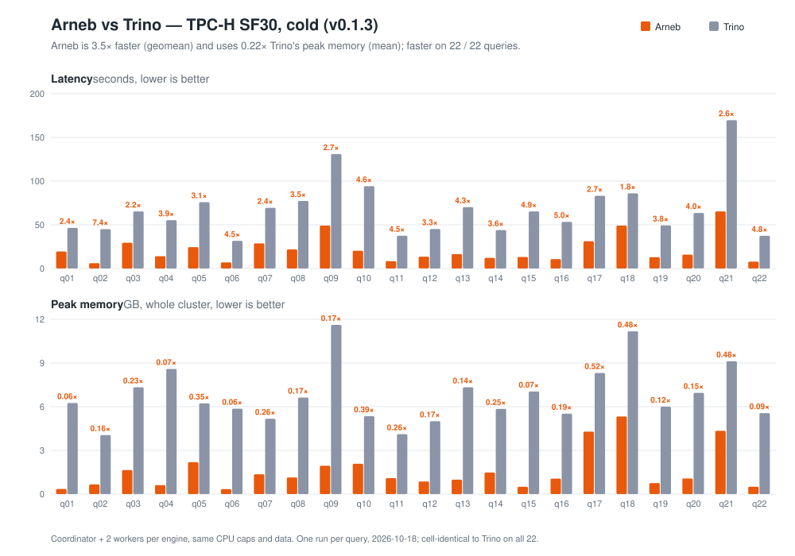

# Arneb

[](https://github.com/formosa-ventures/arneb/releases/latest)
[](https://github.com/formosa-ventures/arneb/actions/workflows/ci.yml)
[](#license)
[](https://arneb.io)
[](https://github.com/formosa-ventures/arneb/stargazers)
[](https://github.com/formosa-ventures/arneb/actions/workflows/deny.yml)
[](https://arneb.io/guide/quickstart)
[](#arneb-vs-trino--tpc-h-sf10)
[](https://arneb.io/guide/performance)
[](https://github.com/formosa-ventures/arneb/commits/main)

A Trino alternative built in Rust. Distributed SQL query engine for federated queries across heterogeneous data sources.

Trino (formerly PrestoSQL) lets users query data where it lives — across object stores, databases, and other systems — using standard SQL. This project aims to achieve similar goals with Rust's performance and safety guarantees.

## Arneb vs Trino — TPC-H SF10

Measured 2026-10-14 on the full 22-query suite. Both engines run as a coordinator
plus two workers, in containers with the same per-node CPU cap, reading the same
Snappy Parquet from RustFS through the same Hive Metastore. `lineitem` is
59,986,052 rows. Host: 10 CPUs, 15.66 GiB of container-runtime memory.

| | Arneb vs Trino |
|---|---|
| **Peak memory** | **0.14× on average — about a seventh of Trino's**, lower on **all 22** queries (best 0.06×, worst 0.31×) |
| **Latency** | **2.3× faster** warm (geomean), faster on **all 22** queries |
| **Correctness** | **Cell-identical to Trino on all 22**, deterministic run-to-run |
| **Footprint** | One self-contained binary (~60 MB). No JVM, no heap tuning, no GC pauses |

At SF30 the gap holds: **3.5× faster** (cold, geomean) at **0.22×** the memory,
faster on all 22 ([details](#sf30-cold-on-a-separate-host)).



### Every query, both protocols

Latency in milliseconds, peak memory in MB. Latency ratios are Trino ÷ arneb
(higher is better for arneb); memory ratios are arneb ÷ Trino (lower is better).
Memory is the peak simultaneous resident set summed across all three cluster
nodes, from the warm run.

| Query | | cold arneb | cold Trino | cold | warm arneb | warm Trino | **warm** | mem arneb | mem Trino | **mem** |
|---|---|--:|--:|--:|--:|--:|--:|--:|--:|--:|
| `q01` | Pricing Summary | 2,068 | 6,309 | 3.1× | 1,852 | 2,678 | **1.4×** | 357 | 6,089 | **0.06×** |
| `q02` | Minimum Cost Supplier | 638 | 5,749 | 9.0× | 492 | 2,017 | **4.1×** | 346 | 3,812 | **0.09×** |
| `q03` | Shipping Priority | 2,338 | 8,276 | 3.5× | 2,147 | 4,001 | **1.9×** | 1,905 | 6,126 | **0.31×** |
| `q04` | Order Priority Checking | 1,425 | 7,014 | 4.9× | 1,264 | 3,157 | **2.5×** | 669 | 6,607 | **0.10×** |
| `q05` | Local Supplier Volume | 2,363 | 7,983 | 3.4× | 1,997 | 3,829 | **1.9×** | 1,115 | 5,761 | **0.19×** |
| `q06` | Forecasting Revenue | 765 | 4,595 | 6.0× | 698 | 1,890 | **2.7×** | 321 | 4,525 | **0.07×** |
| `q07` | Volume Shipping | 2,041 | 8,052 | 3.9× | 1,889 | 4,574 | **2.4×** | 1,202 | 7,590 | **0.16×** |
| `q08` | National Market Share | 2,930 | 9,285 | 3.2× | 2,759 | 5,212 | **1.9×** | 1,585 | 7,101 | **0.22×** |
| `q09` | Product Type Profit | 4,909 | 11,184 | 2.3× | 4,625 | 6,193 | **1.3×** | 1,732 | 8,489 | **0.20×** |
| `q10` | Returned Item Reporting | 2,180 | 10,307 | 4.7× | 2,188 | 4,477 | **2.0×** | 939 | 5,976 | **0.16×** |
| `q11` | Important Stock ID | 762 | 5,355 | 7.0× | 694 | 2,192 | **3.2×** | 265 | 3,349 | **0.08×** |
| `q12` | Shipping Modes | 1,202 | 6,311 | 5.3× | 1,078 | 2,575 | **2.4×** | 436 | 5,504 | **0.08×** |
| `q13` | Customer Distribution | 1,657 | 7,418 | 4.5× | 1,454 | 4,020 | **2.8×** | 447 | 5,668 | **0.08×** |
| `q14` | Promotion Effect | 1,463 | 6,909 | 4.7× | 1,201 | 3,008 | **2.5×** | 924 | 5,034 | **0.18×** |
| `q15` | Top Supplier | 1,145 | 6,846 | 6.0× | 1,033 | 3,351 | **3.2×** | 403 | 6,680 | **0.06×** |
| `q16` | Parts/Supplier Relationship | 1,056 | 7,220 | 6.8× | 988 | 2,283 | **2.3×** | 534 | 4,088 | **0.13×** |
| `q17` | Small-Quantity-Order Revenue | 3,042 | 10,746 | 3.5× | 2,969 | 5,559 | **1.9×** | 1,377 | 8,746 | **0.16×** |
| `q18` | Large Volume Customer | 4,174 | 10,818 | 2.6× | 4,094 | 6,070 | **1.5×** | 2,221 | 10,889 | **0.20×** |
| `q19` | Discounted Revenue | 1,587 | 7,577 | 4.8× | 1,339 | 3,209 | **2.4×** | 671 | 5,302 | **0.13×** |
| `q20` | Potential Part Promotion | 1,384 | 8,651 | 6.2× | 1,254 | 3,738 | **3.0×** | 806 | 5,532 | **0.15×** |
| `q21` | Suppliers Who Kept Orders Waiting | 3,255 | 15,275 | 4.7× | 3,413 | 6,976 | **2.0×** | 1,067 | 7,624 | **0.14×** |
| `q22` | Global Sales Opportunity | 878 | 5,558 | 6.3× | 803 | 2,186 | **2.7×** | 320 | 4,638 | **0.07×** |
| | **aggregate** | | | **4.6×** | | | **2.3×** | | | **0.14×** |

Aggregate is the geometric mean for the latency ratios and the arithmetic mean
for the memory ratios.

### What the two protocols mean

**Cold** times each query on a freshly recreated cluster with the storage side
flushed too: RustFS restarted and the container VM's page cache dropped, so
every byte is re-read from disk. **Warm** recreates the cluster, runs one
untimed query first, identically for both engines, then times the next one.

That choice carries most of the headline, which is why both columns are here.
Warming is worth a median 56% to Trino (43–68% across the 22) because a
recreated JVM re-JITs, and 9% to arneb (−5% to +23%), which has no equivalent
start-up cost. Flushing storage barely moves either engine at SF10 — an earlier
run of these changes that left RustFS and the page cache warm got 4.7× cold /
2.2× warm against this run's 4.6× / 2.3×. **The cold
column is therefore largely a measurement of JVM start-up — quote the warm
one.**

### Memory, in absolute terms

Ratios understate what this means for a deployment, so the five largest gaps:

| Query | Arneb | Trino | Saved |
|---|--:|--:|--:|
| `q18` Large Volume Customer | 2.2 GB | 10.6 GB | **8.5 GB** |
| `q17` Small-Quantity-Order Revenue | 1.3 GB | 8.5 GB | **7.2 GB** |
| `q09` Product Type Profit | 1.7 GB | 8.3 GB | **6.6 GB** |
| `q21` Suppliers Who Kept Orders Waiting | 1.0 GB | 7.4 GB | **6.4 GB** |
| `q07` Volume Shipping | 1.2 GB | 7.4 GB | **6.2 GB** |

A Trino cluster that needs 10.6 GB to run q18 is replaced by one that needs
2.2 GB, on identical hardware and identical data — the difference between a
query that fits on your node and one that does not.

Trino's floor is also high before any query runs: measured across the same
restarts, its three-node cluster sits at **1.99 GB** of committed heap at idle
(1.84–2.15 GB across 44 restarts). Arneb allocates lazily — the same
measurement puts its idle cluster at **0.07 GB**, roughly thirty
times less. Both are counted
the way a container memory limit or `kubectl top` counts them.

### q21, the query Arneb used to lose

`q21` is the four-way correlated `EXISTS` / `NOT EXISTS` self-join over
`lineitem`, the deepest join pipeline in the suite. Warm, arneb lost it in all
five runs through the morning of 2026-10-14 (0.68×–0.84×). It now takes
3,413 ms against Trino's 6,976 ms, **2.0×**, at 0.14× the memory. The semi and
anti joins are hash-partitioned across both workers, and the small outer side
publishes its key set to the `lineitem` scans under `EXISTS` and `NOT EXISTS`,
so about 1.7M matching rows are shuffled instead of all 60M and 38M. That key
set only helps while it arrives before the scans give up waiting for it: at
SF30 the outer side scans 225M rows first, so the planner does not attach it
there and q21 runs with the partitioned joins alone.

### Reproduce it

```bash
git clone https://github.com/formosa-ventures/arneb.git && cd arneb

# Build the engine images (first run only; compiles arneb in release mode).
docker compose -f docker-compose.yml \
               -f docker/arneb-bench/docker-compose.bench.yml build

# One command: preflight the host, seed SF10, measure both engines cold and
# warm, report both side by side.
./benchmarks/tpch/scripts/run_benchmark.sh --scenario=sf10 --mode=both

# Correctness gate: determinism + cell-diff vs Trino, all 22.
python3 benchmarks/tpch/scripts/blast_radius_oracle.py --runs 2
```

`--mode=warm` or `--mode=cold` measures one protocol only. Method, host floors and what is *not*
claimed are in [benchmark methodology](#benchmark-methodology);
[`benchmarks/tpch/README.md`](benchmarks/tpch/README.md) has the full guide.

## Features

- **SQL Support**: SELECT, JOIN (INNER/LEFT/RIGHT/FULL/CROSS), GROUP BY, HAVING, ORDER BY, LIMIT/OFFSET, CASE/COALESCE/NULLIF, CTEs, UNION/INTERSECT/EXCEPT, window functions, subqueries (IN/EXISTS/scalar), DDL/DML (CREATE/DROP TABLE, INSERT, DELETE, views)
- **90 Trino-compatible Scalar Functions**: conditional (IF, TRY, GREATEST, LEAST), string (SPLIT_PART, STRPOS, LPAD/RPAD, CONCAT_WS, `||`, ...), regex (REGEXP_LIKE/EXTRACT/REPLACE/COUNT), math (SQRT, LN, LOG, TRUNCATE, RANDOM, trig, ...), date/time (DATE_ADD, DATE_DIFF, DATE_TRUNC, DATE_FORMAT, DATE_PARSE, FORMAT_DATETIME, YEAR/MONTH/DAY_OF_WEEK/..., FROM_UNIXTIME, NOW) — see [docs/sql/functions.md](docs/sql/functions.md)
- **Arrow-native Execution**: Vectorized columnar processing using Apache Arrow
- **Connectors**: In-memory tables, CSV/Parquet files, S3/GCS/Azure object stores, Hive Metastore catalog (HMS 4.x via `_req` API) with Parquet and ORC tables and partitioned tables (partitions read from HMS, as in Trino), Apache Iceberg tables in the same HMS via table redirection (read-only; field-ID schema evolution) — see [Hive](docs/connectors/hive.md)
- **PostgreSQL Wire Protocol**: Compatible with psql, DBeaver, JDBC, psycopg2, node-postgres, and all standard PostgreSQL clients; per-connection `SET search_path`; SCRAM-SHA-256 password authentication; TLS (`sslmode=require` / `verify-full`)
- **Extended Query Protocol**: Full prepared statement support (Parse/Bind/Describe/Execute/Sync)
- **Trino Client Protocol**: Trino's REST protocol on port 8080, so the `trino` CLI, Trino JDBC, `trino-python-client` (Superset), Metabase's Trino driver and dbt-trino can connect unchanged; HTTPS with Basic authentication against the same users as pgwire — see [Trino client compatibility](docs/guide/trino-clients.md)
- **Security**: TLS on both client protocols, password authentication on both, and a shared secret plus TLS on the coordinator–worker Flight RPC — see [Securing the Cluster](docs/guide/distributed.md#securing-the-cluster)
- **Admission Control**: a cap on running queries with a FIFO queue behind it, a per-query memory limit on every node (SQLSTATE `53200` / `EXCEEDED_LOCAL_MEMORY_LIMIT`), `statement_timeout`, and cancellation that reaches the workers — see [Admission Control](docs/guide/configuration.md#admission-control)
- **pg_catalog / information_schema**: System catalog tables for client schema browser compatibility
- **Distributed Architecture**: Coordinator/Worker separation with Arrow Flight RPC; data-parallel scans, hash-partitioned joins, semi/anti joins and final aggregates, and key-set filters published from the small side of a large semi/anti join to the scans on the big side
- **Web UI**: Dashboard with query monitoring, cluster overview, and worker status
- **TPC-H Benchmark**: 22/22 queries cell-identical to Trino, ~7× lower peak memory and faster on all 22 at SF10 (and on all 22 at SF30 cold), with a one-command benchmark harness and comparison tooling

## Releases

The latest release is **v0.1.2** <!-- x-release-please-version --> — see the [release notes](https://github.com/formosa-ventures/arneb/releases/latest) and [`CHANGELOG.md`](CHANGELOG.md). Releases are source releases (no prebuilt binaries yet); build one from its tag:

```bash
git clone --branch v0.1.2 https://github.com/formosa-ventures/arneb.git  # x-release-please-version
cd arneb && cargo build --release
```

`main` moves faster than releases. How releases are cut and versioned is described in [Contributing → Releases](docs/contributing.md#releases).

## Quick Start

```bash
# Build
cargo build --release

# Start server (standalone mode)
./target/release/arneb

# Start with data tables
./target/release/arneb --config arneb.toml

# Connect with psql
psql -h 127.0.0.1 -p 5432

# ...or with any Trino client (Trino REST protocol, port 8080)
trino --server http://127.0.0.1:8080 --catalog memory --schema default

# Open Web UI
open http://127.0.0.1:6432
```

### Configuration

```toml
# Arneb.toml
bind_address = "127.0.0.1"
port = 5432

[[tables]]
name = "lineitem"
path = "/data/lineitem.parquet"
format = "parquet"

[[tables]]
name = "orders"
path = "/data/orders.csv"
format = "csv"
schema = [
    { name = "id", type = "int32" },
    { name = "customer", type = "utf8" },
    { name = "total", type = "float64" },
]

# Trino client protocol listener (default: enabled on port 8080).
[trino]
enabled = true
port = 8080

# Optional: require passwords (default: type = "none"). pgwire runs
# SCRAM-SHA-256; the Trino listener checks HTTP Basic against the same users
# and needs [tls] when passwords are on.
[auth]
type = "password"

[[auth.users]]
name = "alice"
password_hash = "SCRAM-SHA-256$4096:..."   # generate with: arneb hash-password

# Optional: TLS for pgwire and the Trino listener (HTTPS), one certificate.
[tls]
cert_path = "/etc/arneb/server.crt"
key_path  = "/etc/arneb/server.key"

# Optional: admission control (defaults shown, except the timeout).
[admission]
max_running_queries = 8       # 0 = unlimited
max_queued_queries  = 256
statement_timeout   = "5min"  # default "0" = off
```

See [Authentication](docs/guide/configuration.md#authentication),
[TLS](docs/guide/configuration.md#tls) and
[Admission Control](docs/guide/configuration.md#admission-control) for details,
and [Securing the Cluster](docs/guide/distributed.md#securing-the-cluster) for
the coordinator–worker secret and TLS.

### Distributed Mode

Coordinator handles SQL parsing, planning, and task dispatch. Workers execute plan fragments and serve data via Arrow Flight RPC.

```bash
# Start coordinator (accepts SQL on port 5432, Web UI on 6432)
./target/release/arneb --config arneb.toml --port 5432 --role coordinator

# Start worker (separate terminal — Flight RPC only, no pgwire)
./target/release/arneb --config worker.toml --role worker
```

Worker config (`worker.toml` — no `port` needed since worker has no pgwire):
```toml
bind_address = "127.0.0.1"

# Worker needs access to the same data files as coordinator
[[tables]]
name = "lineitem"
path = "/data/lineitem.parquet"
format = "parquet"

[cluster]
rpc_port = 9091
coordinator_address = "127.0.0.1:9090"
worker_id = "worker-1"
```

## Architecture

```
Standalone / Coordinator local path:
  SQL → Parser → AST → Planner → LogicalPlan → Optimizer
    → ExecutionContext → PhysicalPlan → execute() → Results

Distributed path (coordinator + worker):
  SQL → Parser → AST → Planner → LogicalPlan → Optimizer
    → PlanFragmenter → Fragments
    → QueryCoordinator:
        → Submit leaf fragments to workers via Flight RPC
        → Workers execute fragments, write to OutputBuffer
        → Coordinator executes root fragment locally
    → Results → PostgreSQL wire format
```

### Crate Layout

```
crates/
├── common/        # Shared types, error hierarchy, identifiers
├── sql-parser/    # SQL → AST via sqlparser-rs
├── catalog/       # Catalog/Schema/Table provider traits
├── planner/       # AST → LogicalPlan, optimizer, plan fragmenter
├── execution/     # Physical operators, scalar functions, DataSource trait
├── connectors/    # Memory + File connectors, object store abstraction (S3/GCS/Azure)
├── hive/          # Hive Metastore catalog provider + HiveDataSource
├── iceberg/       # Iceberg reader (hive catalogs redirect Iceberg tables here)
├── hive-metastore/# Auto-generated Thrift bindings from Hive 4.2.0 IDL
├── protocol/      # PostgreSQL wire protocol (Simple + Extended Query), Trino client REST protocol
├── scheduler/     # QueryTracker, NodeRegistry, resource groups
├── rpc/           # Arrow Flight RPC for distributed execution
└── server/        # Main binary, CLI, config, Web UI
```

## Hive Metastore + S3

Run Arneb against a real Hive Metastore backed by S3-compatible storage:

```bash
# 1. Start RustFS + HMS + Trino
docker compose up -d

# 2. Seed TPC-H data (Parquet on RustFS, tables registered in HMS)
docker compose run --rm tpch-seed

# 3. Start Arneb with Hive catalog config
cargo run --bin arneb -- --config benchmarks/tpch/tpch-hive.toml

# 4. Query via psql (or DBeaver / any Postgres client)
psql -h 127.0.0.1 -p 5432 -c "SELECT COUNT(*) FROM datalake.tpch.nation;"

# 5. Tear down
docker compose down
```

Iceberg tables in the same metastore are served by the same `hive` catalog
(`docker compose run --rm iceberg-seed` creates sample tables via Trino). See
[docs/connectors/iceberg.md](docs/connectors/iceberg.md).

## Benchmark methodology

The numbers at the top of this README rest on these choices. They are the parts
that decide whether a comparison is fair, so they are stated rather than left in
the scripts.

- **Identical isolation.** Both engines run as a coordinator plus two workers in
  containers with the same per-node CPU cap, reading the same Parquet from the
  same object store through the same metastore. Neither engine runs natively
  against a containerized rival.
- **Engine rotation.** Only the engine being measured is resident; the other is
  stopped, not idle. Otherwise Trino's committed JVM heap counts against arneb's
  memory reading, and arneb's footprint against Trino's.
- **A clean baseline per query.** The cluster is recreated before each
  measurement, so it starts from its own baseline rather than its
  predecessor's high-water mark. A cold measurement also restarts the object
  store and drops the container VM's page cache, so neither engine reads
  bytes the other — or its own previous run — left cached.
- **Memory is simultaneous, not a sum of lifetime peaks.** Peak is sampled
  during the query as the maximum of the summed cgroup RSS across all three
  nodes — a footprint that actually existed at one instant. Summing each node's
  lifetime peak would report a cluster total that never simultaneously existed.
- **Correctness is a separate gate.** Each query runs twice and is compared
  run-to-run and against Trino as an order-independent, float-tolerant multiset
  at 6 significant figures
  (`benchmarks/tpch/scripts/blast_radius_oracle.py`, 22/22 clean). Row-count
  agreement is not this guarantee — a query can return the right number of wrong
  rows, which is the failure this gate exists to catch.
- **A scenario declares its host floors.** `--scenario=sf10` requires 15 GiB of
  container-runtime memory, 6 CPUs and 40 GB free disk, and refuses the run
  before starting anything if the host cannot meet them. The scale factor
  travels with the measurement into the result document and the report header,
  so a number cannot be read without the scale it was measured at.

### What is not claimed

One host, one scale factor, one run per protocol per query in the table.
Three full runs under identical settings on 2026-10-13/14 put the
run-to-run noise at a median of 4–6% per-query speedup (worst 29%, `q16`
cold) and at most 0.1× on the geomeans. arneb's `q18` peak memory varied
from 2.0 to 4.7 GB across those three because one worker peaked at about twice
the other; it has not recurred since the dataset was re-seeded, and the seed now
writes a fixed file layout
([#126](https://github.com/formosa-ventures/arneb/issues/126)). Single-query
differences under ~30% are not results. Numbers from two different
hosts are not comparable; a scenario makes a run repeatable, not
hardware-independent.

### SF30, cold, on a separate host

All 22 at SF30 cold on a separate benchmark host (2026-10-18, the code released
as v0.1.3), same harness, one run per query. Arneb was faster on **all 22**:
**3.5×** on the geomean, slowest `q18` at 1.8×, fastest `q02` at 7.4×. Peak
memory averaged **0.22×** of Trino's (best 0.06× `q01` and `q06`, worst 0.52×
`q17`), and the oracle was 22/22 clean, deterministic over two runs; the chart
at the top of this README plots it. The v0.1.2 run got 3.7× / 0.21×; v0.1.3
adds no performance work, and the difference is inside run-to-run noise.
v0.1.3 does account Parquet scan buffers in the memory pool, and this run
confirmed that it moved no join into an earlier spill. These
are cold numbers only; SF30 has not been measured warm, and a different host
means they are not comparable with the SF10 table above. Per-query figures are
on the [Performance](https://arneb.io/guide/performance) page, and the chart is
drawn from [its data](docs/public/perf/tpch-sf30-cold-2026-10-18.csv) by
[`plot_comparison.py`](benchmarks/tpch/scripts/plot_comparison.py).

`q11` numbers measured at SF10 before 2026-10-13 timed an empty result: the
query hard-coded the SF1 threshold fraction, so above SF1 both engines filtered
out every row. It now scales with SF; see
[`benchmarks/tpch/README.md`](benchmarks/tpch/README.md#q11).

The full guide — prerequisites, host floors, the scenario reference and the
per-query report tooling — is in
[`benchmarks/tpch/README.md`](benchmarks/tpch/README.md).

## Development

```bash
cargo build                      # Build all crates
cargo test                       # Run all tests
cargo clippy -- -D warnings      # Lint
cargo fmt -- --check             # Check formatting
```

## License

Apache-2.0
